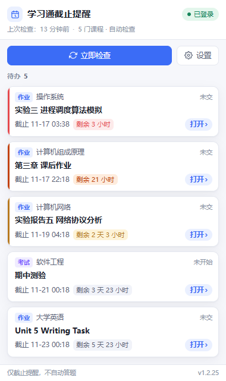
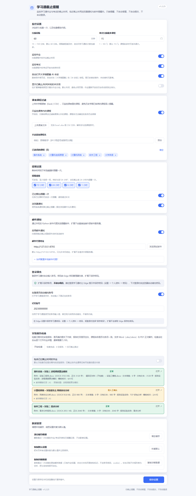

# v1.2.25 发布说明

第一个公开发布版本。

学习通（超星）网页版不会主动告诉你「哪份作业快截止了」——作业散落在各门课里，要一门门点进去看；
等想起来时往往已经过了截止时间。这个扩展把这件事自动化：**定时扫描全部课程的作业与考试，
在临近截止时用浏览器通知和邮件提醒你**，并支持学习通登录页账号自动填充。

它只做提醒，不代做作业。

---

## 界面

扩展弹窗——按剩余时间排序的待办列表，点「打开」直接跳到对应作业页：

设置页——监控、课表过滤、提醒、邮件、登录填充、实验报告检查、数据管理：

---

## 功能

### 截止监控与提醒

- 定时扫描（默认 60 分钟）全部课程的**作业**与**考试**，计算剩余时间；
- 默认在剩余 **72 / 24 / 6 / 1 小时**各提醒一次，阈值可自行增减，过期时再提醒一次；
- 浏览器通知点击即可打开对应学习通页面；
- 每个提醒节点只提醒一次，不会反复打扰（去重键基于条目的稳定标识，不是剩余时间）。

### 邮件提醒（走本机代理，不发密码给第三方）

- 项目自带一个**只用 Python 标准库**的本地 SMTP 代理（`mail-proxy/`），扩展只与本机
  `127.0.0.1:8765` 通信，邮箱授权码只存在你本机配置文件里；
- 支持 QQ / 163 / Outlook 等邮箱的 SMTP 授权码，支持 SSL 与 STARTTLS；
- 学习通会话失效时也会发邮件提醒你重新登录；
- 代理超过 3 小时收不到扩展心跳时，会发一封「插件可能没有运行」的提醒（限流 6 小时一次）。

### 课表课程过滤

- 上传本学期课表（Excel `.xlsx` / CSV），自动识别课程名；
- 打开过滤后只监控课表内的课程，历史学期已结束的课程不再混进提醒；
- 零依赖解析 `.xlsx`（自己实现 zip 中央目录 + `DecompressionStream`），支持合并单元格、GBK CSV。

### 登录页账号自动填充

- 在学习通登录页自动填入账号（可选）；
- **密码不保存**，交给 Edge 自带的密码管理器。

### 大学搜题酱联动

- 跳转到作答页后，尝试自动点击「大学搜题酱」的「AI 会话」按钮（可在设置页关闭）；
- 仅在作答页生效，未装该插件时静默跳过。

### 实验报告检查

检查你**已提交**的实验报告是否出现「交了但内容为空/栏目缺失/交错了作业」这类情况：

- 支持 Word（`.docx` / `.doc`）与 PDF 正文提取，**零第三方依赖**（自己实现 docx 解压、doc 的
  OLE2 复合文档与 Piece Table 解析、pdf 内容流解析；按文件魔数分派，避免学习通把 `.doc` 误标成 docx）；
- **区分题目区与作答区**：教师提供的模板、数据集等材料不会计入检查；
- **同名附件自动识别**：题目区模板与你提交的文件常常同名，按区域标记 + 文件大小判断哪份是你的；
- **遍历同源 iframe**：作答区常出现在富文本编辑器的 iframe 里，会递归采集并等待异步渲染；
- **教师模板骨架比对**：从题目区的模板文件提取栏目骨架（实验目的 / 实验内容 / 实验结果及分析 …），
  与你报告的栏目结构比对，覆盖率高时说明结构一致，不再用「标题字面重合率」这种不可靠判据；
- **跳过已截止与互评阶段的作业**：进入互评说明提交窗口已关，界面上显示的「剩余时间」是互评截止时间，
  不是提交截止时间；
- 结果在设置页列出，**每条都能点击跳转到对应报告页面**自行核对。

---

## 安装

1. 下载本仓库（`Code` → `Download ZIP`，或 `git clone`）；
2. Edge 地址栏输入 `edge://extensions/`，打开 **开发人员模式**；
3. 点 **加载解压缩的扩展**，选择仓库里的 `extension` 目录（即含 `manifest.json` 的那一层）；
4. 在弹出的设置页里登录学习通，并按需配置监控间隔与提醒阈值。

邮件提醒需要另外启动本地代理：编辑 `mail-proxy/config.example.json` 填好 SMTP 信息，
复制为 `config.json`，然后双击 `mail-proxy/start.bat`。

详细步骤见 [README](../README.md)。

---

## 环境要求

| 组件             | 要求                          |
| -------------- | --------------------------- |
| Microsoft Edge | Chromium 126+（Manifest V3）  |
| Python         | 3.10+，仅邮件代理需要（标准库，无需 pip）   |
| Node.js        | 不需要（仅开发期跑测试用）               |

---

## 隐私与边界

- 扩展**不保存密码**、**不自动登录**、**不自动答题**、**不自动提交**；
- 采集在后台隐藏标签页中完成，不操作你正在使用的标签页；
- 所有数据存在本机扩展存储里，不上传任何服务器；
- 邮件只经你本机的 Python 代理发出，邮箱凭据不经过扩展。

---

## 验证情况

- 扩展自动化测试 **161 项**、邮件代理 Python 测试 **47 项**全部通过；
- CI（`.github/workflows/ci.yml`）在 Ubuntu 上跑：源码语法检查、全部测试、JSON 校验、manifest 结构校验；
- 从干净环境重新克隆后复跑，测试同样全绿。

---

## 已知限制

- 学习通页面结构可能随版本调整，若某类作业采集不到，设置页的「页面结构诊断」会显示
  iframe 数量、选择器命中情况，便于反馈定位；
- 实验报告检查判断的是「报告是否完整提交」，**不判断内容对错**（只统计栏目是否有内容）；
- 只支持 Edge / Chromium 系浏览器，Manifest V3。

---

## 反馈

遇到问题请开 [Issue](https://github.com/045zd/Plugin-development/issues)，附上：Edge 版本、
扩展版本（设置页右上角）、设置页「页面结构诊断」里的内容。**请勿粘贴账号密码或邮箱授权码。**
